<p align="center">
  <a href="https://github.com/ArtyaEXE/claude-mods"></a>
</p>

<p align="center">
  I build web apps that feel instant, Telegram bots and Mini Apps people actually use,<br>
  and tools that make AI coding agents reliable on Windows.
</p>

<p align="center">
  <a href="https://github.com/ArtyaEXE/claude-mods"></a>
  <a href="mailto:arutyunyan9810@gmail.com"></a>
  
</p>

---

### 🛠️ Now building: [claude-mods](https://github.com/ArtyaEXE/claude-mods)

Thirteen open-source mods for Claude Code on Windows. They stop commands that would fail in PowerShell, keep Cyrillic out of mojibake, snapshot your work before `git reset --hard`, run the tests after Claude's changes, ping you on Windows or Telegram when a turn ends, and put screenshots and files into the prompt in one click.

<p align="center">
  <a href="https://github.com/ArtyaEXE/claude-mods"></a>
</p>

<p align="center">
  <a href="https://github.com/ArtyaEXE/claude-mods/releases/latest"></a>
  <a href="https://github.com/ArtyaEXE/claude-mods/actions/workflows/ci.yml"></a>
  
  
  <a href="https://github.com/ArtyaEXE/claude-mods/stargazers"></a>
</p>

```
/plugin install hud --marketplace ArtyaEXE/claude-mods   # or any of the thirteen
```

### 🧰 What I ship with

<p align="center">
  
</p>

<p align="center"><sub>Most of my commercial work lives in private GitLab repositories: this card counts it without naming it.</sub></p>

### 🐍 Activity

<p align="center">
  <picture>
    <source media="(prefers-color-scheme: dark)" srcset="https://raw.githubusercontent.com/ArtyaEXE/ArtyaEXE/output/snake-dark.svg">
    
  </picture>
</p>

<details>
<summary>🇷🇺 По-русски</summary>

<br>

Привет! Я Артур, full-stack разработчик. Делаю быстрые веб-приложения на Svelte, Vue и TypeScript, Telegram-ботов и Mini Apps, а сейчас — [claude-mods](https://github.com/ArtyaEXE/claude-mods): тринадцать открытых модов, которые делают Claude Code удобным и безопасным на Windows (защита от команд, которые упадут в PowerShell, кириллица без кракозябр, снимки перед `git reset --hard`, тесты после правок, уведомления в Windows и Telegram, скриншоты и файлы в промпт в один клик). Пишите: arutyunyan9810@gmail.com.

</details>
